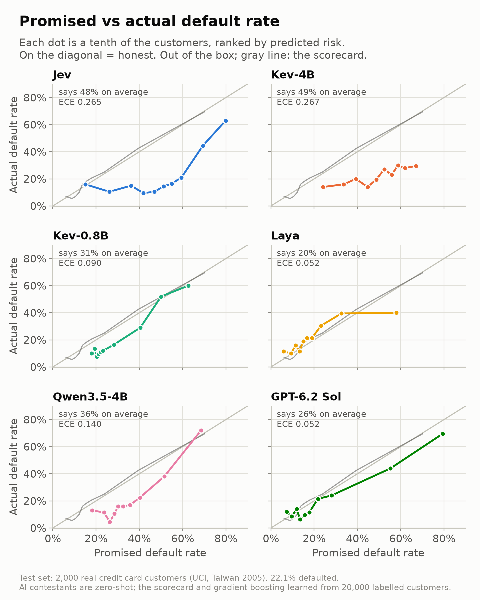

# Can AI actually know when it's wrong?

Banks are audited on whether their risk scores are honest: if a model says "30% chance of default", about 30% of those customers should default. This project holds AI decision models to the same standard on 2,000 real credit card customers, and compares them with a logistic-regression scorecard and gradient boosting.

It's the experiment behind a blog series. Every post uses the same customers, the same test set and the same saved predictions:

| | Post | What it asks | Source and numbers |
|---|---|---|---|
| 1 | [Can AI know when it's wrong?](https://nishzsche.github.io/2026/11/23/can-ai-know-when-its-wrong/) (23 November 2026) | When an AI model says "30% chance of default", is it right? Six AI models answer cold, against two models trained on 20,000 customers | [`writeup/blog.md`](writeup/blog.md); [results below](#post-1s-results); the method and every check in [the deep dive](writeup/deep_dive.md) |
| 2 | [Why 99% accuracy can still be a disaster](https://nishzsche.github.io/2026/11/24/why-99-percent-accuracy/) (24 November 2026) | Would judging the same models by accuracy have picked the right one for a lender? | [`writeup/accuracy_post.md`](writeup/accuracy_post.md); `analysis/accuracy.py` → `results/accuracy.json` |
| 3 | [I gave AI the same data as a bank's model. It caught up.](https://nishzsche.github.io/2026/11/25/fair-fight/) (25 November 2026) | What happens when the AI models learn from the same 20,000 customers the trained models did | [`writeup/fair_fight_post.md`](writeup/fair_fight_post.md); `analysis/fair_fight.py` → `results/fair_fight.csv`; trained weights in the [`m6-weights` release](https://github.com/nishzsche/can-ai-know-when-its-wrong/releases/tag/m6-weights) |
| 4 | [I shrank AI models. It saved memory, not time.](https://nishzsche.github.io/2026/11/27/shrinking-ai-models/) (27 November 2026) | Do post 3's trained models stay honest when shrunk to 8, 4, 3 and 2 bits, and are they cheaper to run? | [`writeup/quantization_post.md`](writeup/quantization_post.md); `analysis/quantization.py` → `results/quantization.csv`; `analysis/speed_report.py` → `results/speed.csv`, `results/speed_throughput.csv` |
| 5 | [Why AI can write code but struggle to read a table](https://nishzsche.github.io/2026/11/27/reading-tables/) (27 November 2026) | Does writing the same numbers in another layout (Markdown, CSV, JSON, sentences, a realigned table) change what six zero-shot AI models conclude? | [`writeup/formats_post.md`](writeup/formats_post.md); `analysis/layouts.py` → `results/layouts.csv` |

Next in this repo: teaching a small model to say "I don't know", on the same customers. Posts that need other data will get their own repos and link back here. The full plan is in [PLAN.md](PLAN.md).



## In short

**Post 1: zero-shot AI against trained models.**

- **Most AI models overstate default risk out of the box.** Jev and Kev-4B predict about 48% on average; 22.1% of these customers defaulted.
- **One sentence stating the portfolio's default rate helps four of the six** (three clearly, plus Qwen's numbers). It makes no clear difference to Laya, makes Kev-0.8B worse (ECE 0.090 → 0.269), and costs Qwen ranking (AUC 0.744 → 0.710).
- **Shifting each model's log-odds so its mean equals the known 22.1% rate** needs no per-customer labels and beats the sentence for four of six (Kev-4B: ECE 0.267 → 0.018).
- **GPT-6.2 Sol and Laya are the best calibrated out of the box** (ECE 0.052). But Sol knows this dataset and its exact default rate, so its result isn't a clean zero-shot test (see [Checks](#checks-on-these-results)).
- **The table layout matters for one model.** Template v2 shows each payment beside the same month's bill, though payments usually settle the previous month's. Realigned, Kev-4B's mean drops from 0.486 to 0.356 and its AUC rises from 0.594 to 0.720 on test; Laya gets worse; the rest barely change. Results are reported for both layouts.
- **No AI contestant out-ranks the trained models.** Gradient boosting's AUC is 0.789 and the scorecard's 0.777; the best AI contestants reach 0.757 and 0.754. Paired against the scorecard, the closest six gaps have Holm-adjusted p ≈ 0.06. Approving the safest 80%, the scorecard's approvals default at 13.6% and Sol's at 13.4%.
- **Recalibrating on 2,000 labelled customers** brings every AI contestant to an ECE of about 0.02–0.04 (equal-mass bins; a perfectly calibrated model scores up to ~0.03 here). Jev, Laya and Qwen still fail Hosmer–Lemeshow. A scorecard trained on the same 2,000 labels reaches AUC 0.758 and ECE 0.024.

**Post 2: accuracy against a lending decision.** Built from post 1's predictions, with no new runs. The profit figures assume a paying customer earns a lender 1 unit and a defaulter costs it 4, an illustrative ratio; the post checks others.

- **Doing nothing is 77.9% accurate.** Saying "won't default" to everyone is right that often, because 22.1% defaulted. The most accurate model, gradient boosting at 82.5%, beats it by 4.6 points, and Laya (76.5%), Jev (60.9%) and Kev-4B (55.2%) fall below it.
- **Doing nothing loses money anyway.** Approving everyone loses 105 units per 1,000 customers.
- **Accuracy can't tell a useful model from a useless one.** Qwen ties the scorecard on accuracy (81.9% against 81.8%). Taken at its word (approve anyone it rates under 20%), it approves 5 customers in 100 and earns 17 per 1,000, against the scorecard's 284.
- **Honest percentages can be used as they come.** Gradient boosting, the scorecard and Sol earn about the same at their own percentages as with a cut-off chosen on the 2,000 labelled tune customers. Kev-0.8B earns 99 at its word and 306, the most of any model, with the chosen cut-off.
- As in post 1, the scorecard and gradient boosting learned from 20,000 labelled customers and the AI models answered cold.

**Post 3: the fair fight.** Every AI model gets the same 20,000 `train` customers the baselines learned from. Kev-4B, Kev-0.8B, Qwen3.5-4B and Laya are fine-tuned on them. Two tabular foundation models, Kumo-Tabular and TabICLv2, read them as examples with no training. Jev and Sol, which can't be fine-tuned, see each customer's 20 most similar `train` customers in the prompt.

- **Trained, they catch up.** The six that trained or read all 20,000 rank at AUC 0.778–0.794, against gradient boosting's 0.789 and the scorecard's 0.777. Kev-4B goes from 0.594 to 0.792.
- **Caught up, not ahead.** None of the six can be told apart from gradient boosting. Against the scorecard, only Kev-4B is clearly better (+0.015, Holm-corrected over eight models).
- **Honest after the same correction.** Recalibrated on tune, every model is within chance of perfect calibration (ECE under 2.5 points) except Kev-4B (3.3). Sol's 1.2 carries the usual caveat: it recognizes this dataset and knows its default rate.
- **Training is not calibration.** Straight out of fine-tuning, both Kev models under-predict (18–19% against 22.1%). Kev's maker recipe ends with a temperature fit, which wasn't applied.
- **The tabular foundation models match the best with no training run.** They're close to calibrated out of the box (2.0 and 2.5 points) and cost under a cent per 1,000 decisions.
- **Twenty examples aren't enough.** Sol (0.762) only matches simply averaging the outcomes of its 20 look-alikes (0.764), and Jev ranks worse (0.743). Sol costs about 10 dollars per 1,000 decisions.
- **A ceiling:** eight very different models land within 0.02 of each other, and a scorecard trained on 2,000 customers reaches 0.758.
- The only tuning in the contest went to gradient boosting: its number of rounds was chosen by cross-validation within `train`.

**Post 4: shrinking the trained models.** Post 3's fine-tuned Kev-4B, Kev-0.8B and Qwen3.5-4B, quantized with bitsandbytes (8-bit LLM.int8, 4-bit NF4) and HQQ (4, 3 and 2 bits). Neither method uses any data, and each shrunk version is compared only with its own full-size run.

- **Ranking held down to 4 bits.** With either method, all three stayed within 0.005 of their full-size AUC. At 3 bits only Kev-4B dropped detectably (0.792 → 0.776). At 2 bits all three collapsed: 0.60, 0.45 and 0.43.
- **Honesty held above 2 bits.** The only change in ECE bigger than chance (paired bootstrap, Holm over 15 comparisons) was an improvement: Kev-0.8B at 4-bit HQQ, 4.4 → 2.3 points, a side effect of rounding. At 2 bits, 15 to 46 points off.
- **The summary scores hid the customers moving.** At 3 bits, 62% of Kev-0.8B's customers moved 5 points or more, while its AUC (0.786) and ECE (3.1 points) looked as good as full size. Its calibration slope went from 0.86 to 1.31.
- **Lending decisions changed.** At the full-size model's cut-off, 8 bits changed 0.9–3.3% of approve/decline decisions, 4-bit NF4 1.5–3.4% and 3 bits 10–20%. Running the same full-size model again through the new code changed 0.2–1.5%.
- **It saved memory, not time.** At 4 bits the 4B models needed 3.5–3.9 GB at peak instead of 8.7–8.9. On a tuned GPU, only Kev-4B on GemLite answered faster than full size (83 ms against 93); tuning the setup made full size up to 3 times faster. FP8 matched full size for Qwen and gave no answers on either Kev model. Failures are recorded in `results/checks/quant_failures.json`.
- As in post 3, all three models learned from the same 20,000 `train` customers as the scorecard.

**Post 5: the same customers in other layouts.** The six zero-shot AI models from post 1, on the same 2,000 test customers with the same values in four formats (Markdown, CSV, JSON, sentences; `data/formats.py`, checked character for character by `tests/test_formats.py`) plus post 1's realigned table, each compared with its own run on the original table.

- **Ranking depended on the layout for two models.** Laya ranged from 0.716 (sentences) to 0.478 (JSON, worse than a coin flip); Kev-4B rose from 0.594 to 0.729 with JSON. Kev-0.8B and Sol showed no change bigger than chance. In all, 11 of 30 AUC changes and 17 of 30 ECE changes were bigger than chance (paired bootstrap, Holm over 30).
- **Answers moved even where the ranking held.** Laya's moved 26 points per customer with CSV and JSON (rank correlation with the original 0.08 for JSON), four times post 4's 3-bit shrinking. Sol moved 2.6 to 2.9 points, about its own run-to-run noise (2.5); it knows this dataset.
- **Lending decisions changed.** At the cut-off chosen on tune for the original table, up to 63% of decisions changed (Laya with JSON, which approves nobody); Kev-0.8B with CSV changed 25% although its ranking held. Asking the original table again changed 0 to 3.5%.
- No layout was chosen on test: the headline results in every post stay on the original table, fixed before any run.

## Post 1's results

Test set: 2,000 customers, 22.1% of whom defaulted. **The baselines learned from 20,000 labelled customers. The AI contestants are zero-shot:** each sees one customer's summary, with no labelled examples.

**Baselines (trained):**

| Contestant | Mean predicted | AUC | ECE |
|---|---:|---:|---:|
| Scorecard (WoE + logistic regression) | 21.8% | 0.777 | 0.014 |
| Gradient boosting (LightGBM) | 21.8% | 0.789 | 0.017 |

**AI contestants (zero-shot):**

| Contestant | Model | Mean predicted, out of the box | AUC: out of the box / told the base rate | ECE: out of the box | ECE: told the base rate | ECE: recalibrated |
|---|---|---:|---:|---:|---:|---:|
| `jev` | TypeSafe Jev 1.14 (API) | 48.1% | 0.712 / 0.749 | 0.265 | 0.155 | 0.019 |
| `kev-4b` | Kev-4B v1.0 (open weights) | 48.6% | 0.594 / 0.757 | 0.267 | 0.034 | 0.003 |
| `kev-0.8b` | Kev-0.8B v1.0 (open weights) | 30.5% | 0.750 / 0.752 | 0.090 | 0.269 | 0.023 |
| `laya` | Laya, 421M encoder (open weights) | 20.4% | 0.666 / 0.669 | 0.052 | 0.040 | 0.041 |
| `qwen-logprobs` | Qwen3.5-4B, P(yes) from token probabilities (open weights) | 35.5% | 0.744 / 0.710 | 0.140 | 0.074 | 0.039 |
| `frontier-verbal` | GPT-6.2 Sol, asked for a percentage (API) | 26.0% | 0.754 / 0.755 | 0.052 | 0.032 | 0.017 |

- **ECE** (expected calibration error) is the average gap between predicted and actual default rates across bins of predicted risk. Lower is better; 0.05 means 5 percentage points.
- **AUC** measures ranking only: whether defaulters get higher scores than non-defaulters.
- **"Told the base rate"** adds one sentence before the question: "In this portfolio, about 22.1% of customers miss next month's payment."
- **"Recalibrated"** maps each contestant's out-of-the-box probabilities through Platt scaling or isotonic regression. The calibrator is fitted on the separate 2,000-customer tune split and applied to test unchanged.
- **GPT-6.2 Sol has seen this dataset.** It names every account summary as the UCI data and gives its exact default rate (22.12%), even with the currency, dates and repayment codes removed. Read its out-of-the-box calibration as that of a model that knows the population, not zero-shot honesty. It also reproduced 31 customers verbatim. Three are in the test set, and leaving them out moves no metric by more than 0.0006. See [`data/contamination.md`](data/contamination.md).

`results/summary.csv` has every metric for every contestant and condition, with 95% bootstrap intervals (about ±0.03 for AUC), plus cost and latency. Every prediction is saved in `results/predictions/` with its probability, model version, condition, latency and cost. Pinned model revisions and library versions are in `results/run_manifest.json`.

[`PREDICTIONS.md`](PREDICTIONS.md) holds the author's guesses, committed before any run. One of four held: the base rate did help most contestants. Jev wasn't the most honest, Laya wasn't the least, and no AI contestant beat the scorecard at ranking.

**Post 1's charts** (`results/figures/`):

1. [Promised vs actual default rate](results/figures/1_promised_vs_actual.png), by decile of predicted risk (shown above).
2. [The honesty arc](results/figures/2_honesty_arc.png): ECE out of the box, told the base rate, and recalibrated.
3. [Ranking](results/figures/3_ranking_auc_ks.png): AUC with 95% intervals, and KS.
4. [What a bank would see](results/figures/4_risk_bands.png): promised vs actual default rates by risk band.
5. [Cost vs ranking](results/figures/5_cost_vs_auc.png).

Post 2's charts are `post2_*.png`, post 3's are `m6_*.png` post 4's are `post4_*.png` and post 5's are `post5_*.png`. Every chart also has a `-dark.png` version for the blog's dark mode.

### Cost and speed

Out of the box, per 1,000 decisions. API costs are what OpenRouter billed. The open models' costs are their L4 GPU time at $0.44/hour, run one request at a time.

| Contestant | Cost per 1,000 decisions | Median latency |
|---|---:|---:|
| GPT-6.2 Sol | $0.74 (told the base rate: $1.02) | 1,984 ms |
| Jev | $0.021 | 432 ms |
| Qwen3.5-4B | $0.018 | 142 ms |
| Kev-4B | $0.017 | 139 ms |
| Kev-0.8B | $0.005 | 39 ms |
| Laya | $0.002 | 16 ms |
| Scorecard, gradient boosting | ~$0 once trained | <1 ms |

The whole project, every check included, cost $14.20 in API calls plus a few dollars of GPU time.

### Checks on these results

| Check | What it found | Where |
|---|---|---|
| Memorization (tabmemcheck, plus a longer deterministic version) | Sol reproduces 31 customers from the data file verbatim, dense through customer 33. Qwen3.5-4B shows none. The decision models can't be probed. | [`data/contamination.md`](data/contamination.md) §1 |
| Results without the memorized customers | Leaving out Sol's 3 memorized test customers moves no metric for any contestant by more than 0.0006 | `results/summary_excluding_memorized.csv` |
| Recognition | Asked which public dataset a summary came from, Sol names this one for 53 of 53 and gives its default rate as 22.12%. The question invites a dataset name, and there's no negative control. | `contamination.md` §3 |
| Disguise: recognition | With NT$, the 2005 dates and the raw codes removed, Sol still names it: 50 of 50 | `contamination.md` §4 |
| Disguise: predictions | Every AI contestant re-answers the 2,000 test customers with those cues removed, plus 200 on the original summaries for run-to-run noise. Mean prediction: Jev +4.1 points, Qwen +3.4, Kev-4B +1.5, Sol +0.8, Kev-0.8B −1.3, Laya −4.8 (noise ≤ 0.3). If knowing "Taiwan 2005" had raised the numbers, hiding it should lower them; most went up. The models are sensitive to wording, not to the era. | `results/checks/disguise_summary.json`, `contamination.md` §4 |
| Layout | Template v2 pairs each payment with the same month's bill (quirk 3 below), which could tilt the comparison. Re-asked on tune and test with each bill beside the following month's payment. On test: **Kev-4B** mean 0.486 → 0.356, ECE 0.267 → 0.135, AUC 0.594 → 0.720 (v2 hurt it); **Laya** mean +6.0 points, AUC 0.666 → 0.569; Jev, Qwen, Kev-0.8B and Sol within 1 point, AUC down 0.007–0.029 (v2 suited them). Headlines stay v2, the pre-registered template. | `results/checks/disguise_summary.json` |
| False base rate | Told "about 10%" instead of 22.1%, Sol's mean falls from 0.258 to 0.175: 69% of the change in the stated rate (95% interval 64–73%), about half the distance to 10%, with its ranking unchanged. | `contamination.md` §5 |
| Statistics | Equal-mass ECE, a perfect-calibration noise floor, Hosmer–Lemeshow by decile, paired AUC tests with Holm correction, approval at 80%, the label-free shift and a 2,000-label scorecard | `analysis/robustness.py` → `results/robustness.json` |
| Qwen option order | Swapping which letter means "yes" leaves its mean P(yes) almost unchanged (−0.004) | `results/checks/qwen_order_swap.jsonl` |
| Qwen probability readout | jevper 0.7.12 lets a low-ranked spelling of an option overwrite a high-ranked one (0.32 read as 0.00004). The runner computes P(yes) itself, and the bug is [reported upstream](https://github.com/zhulinchng/jevper/issues/1). | `runners/qwen_logprobs.py` |

## Data

**Default of Credit Card Clients**: 30,000 credit card customers of a bank in Taiwan, April–September 2005, and whether each one defaulted on the next month's payment.

- Source: UCI Machine Learning Repository, dataset 350, loaded with `ucimlrepo` 0.0.7. UCI last updated it on 29 March 2024; `data/raw/source.json` records the content hash we used.
- **Licence: [CC BY 4.0](https://creativecommons.org/licenses/by/4.0/)**, as stated on the [UCI dataset page](https://archive.ics.uci.edu/dataset/350/default+of+credit+card+clients).
- **Please cite:**
  - Yeh, I. C., & Lien, C. H. (2009). The comparisons of data mining techniques for the predictive accuracy of probability of default of credit card clients. *Expert Systems with Applications*, 36(2), 2473–2480. https://doi.org/10.1016/j.eswa.2007.12.020
  - Yeh, I-C. (2009). Default of Credit Card Clients [Dataset]. UCI Machine Learning Repository. https://doi.org/10.24432/C55S3H

Changes we made: we dropped four columns (below), renamed the columns from UCI's `X1`–`X23` to their documented names, and rendered each customer as a short text summary.

### What the models see

Every model sees only financial behaviour:

- `LIMIT_BAL`: credit limit (NT$)
- `PAY_0`, `PAY_2`–`PAY_6`: repayment status, September back to April 2005
- `BILL_AMT1`–`BILL_AMT6`: bill amounts, September back to April 2005
- `PAY_AMT1`–`PAY_AMT6`: amounts paid, September back to April 2005

**Excluded from every model input: `SEX`, `MARRIAGE`, `AGE`, `EDUCATION`.** Using protected characteristics in credit decisions is off-limits in practice. Leaving them out also keeps this about whether the probabilities are honest, not about demographics. `data/load.py` drops them before anything is saved.

The target is `default_next_month` (UCI's `Y`, "default payment next month"). The overall default rate is **22.12%** (6,636 of 30,000).

### How each customer is shown to the AI models

The AI models read text, so each customer becomes one fixed summary (`data/render.py`, template `v2`). Every AI contestant sees the same text:

```
Credit card account summary
Credit limit: NT$100,000

Month (most recent first) | Bill amount | Amount paid | Repayment status
Sep 2005 | NT$4,829 | NT$0 | paid on time (code -1)
Aug 2005 | NT$0 | NT$0 | paid on time (code -1)
Jul 2005 | NT$0 | NT$0 | not late (code -2)
...
```

The question is "Based on this account summary, will this customer miss next month's payment?" and the model's probability of "yes" is taken as its predicted default risk. In the "told the base rate" condition, one sentence goes before the question: "In this portfolio, about 22.1% of customers miss next month's payment." The summary text doesn't change.

Summaries are 164 tokens on average and 192 at most with Laya's tokenizer, which leaves about 320 tokens for the summary. With Kev's (Qwen3.5) tokenizer they're 218 on average and 250 at most.

### Known data quirks

We document these rather than hide them.

1. **Repayment-status codes −2 and 0 aren't documented.** Yeh & Lien define −1 as "pay duly" and 1–9 as months of payment delay; −2 and 0 fall on the not-late side of that scale. The often-quoted "common interpretation" (−2 = no balance / card not used, −1 = paid in full, 0 = paid the minimum) is contradicted by the data:

   | Code | Common interpretation | What the train split shows |
   |---|---|---|
   | −2 | "no balance / card not used" | 40.6% of these months still carry a positive bill (48.5% non-zero across all 30,000 customers) |
   | −1 | "paid in full" | 24% of payments fall short of the previous bill (documented only as "pay duly") |
   | 0 | "paid the minimum" | 95% are partial payments, but "minimum" can't be verified |

   So the summaries (template v2) say only what's documented or follows from the scale, and always show the raw code: −2 → "not late (code −2)", −1 → "paid on time (code −1)", 0 → "not late (code 0)", 1–9 → "N months late (code N)". This gives the AI models the same information the trained baselines see, without wording that would mislead them. (Template v1 used the common interpretation and was replaced before any runs.) Code 9 never occurs.
2. **Code 1 ("one month late") appears almost only in September**: 3,688 times there, but 28, 4, 2, 0 and 0 times in August–April. The coding seems to differ between months.
3. **Payments usually settle the previous month's bill.** "Amount paid" in a month matches the *previous* month's bill 21,213 times, against 3,720 for the same month. We keep UCI's month alignment, so each row shows that month's bill and that month's payment. The trained baselines learn the real relationship from data; an AI model reading the table might not, so this could tilt the comparison against the AI contestants. It wasn't flagged as a tilt before the runs. The layout check (above) measures it: realigned, Kev-4B does much better and Laya worse, and the rest barely change.
4. **Negative bills (credit balances):** 3,932 entries across 1,930 customers, down to −NT$339,603. The summary shows them as `-NT$1,234 (credit)`.
5. **Bills above the credit limit:** 8,274 entries.
6. **Identical inputs:** 817 customers have exactly the same financial fields as another customer (795 have no bills or payments at all), and some of them have different outcomes.
7. Amounts are 2005 NT$ and are kept as they are.

### Splits

The splits are stratified on the target with a fixed seed (`data/splits.py`):

| split | customers | defaults | default rate | used for |
|---|---:|---:|---:|---|
| train | 20,000 | 4,424 | 22.12% | training the scorecard and GBM; in post 3, also training the AI models and supplying their examples |
| tune | 2,000 | 442 | 22.10% | recalibration, threshold choices and post 2's cut-offs |
| test | 2,000 | 442 | 22.10% | scoring every contestant; nothing is tuned on it |
| reserve | 6,000 | 1,328 | 22.13% | unused |

### Memorization

This is a famous dataset, so `data/contamination.md` records what each contestant could have seen in training, along with the LLM memorization tests.

## Reproduce

**Re-score from the saved predictions.** This needs no API key or GPU, and reproduces `results/summary.csv` and the figures exactly:

```bash
uv sync
uv run python analysis/summarize.py   # results/summary.csv, summary_detail.json, summary_excluding_memorized.csv
uv run python analysis/figures.py     # results/figures/
uv run python analysis/robustness.py  # results/robustness.json

# post 2
uv run python analysis/accuracy.py    # results/accuracy.json and post 2's charts

# post 3
uv run python analysis/fair_fight.py          # results/fair_fight.csv, fair_fight.json
uv run python analysis/seeds.py               # results/seeds.json (the re-run check)
uv run python analysis/fair_fight_figures.py  # post 3's charts

# post 4
uv run python analysis/quantization.py          # results/quantization.csv
uv run python analysis/speed_report.py          # results/speed.csv, speed_throughput.csv, speed.json
uv run python analysis/quantization_figures.py  # post 4's charts and social card

# post 5
uv run python analysis/layouts.py          # results/layouts.csv, layouts.json
uv run python analysis/layouts_figures.py  # post 5's charts and social card
```

**Rebuild from the raw data:**

```bash
uv run python data/load.py && uv run python data/splits.py   # fetch data, build splits
uv run python data/render.py --split tune --split test       # render account summaries
uv run python data/render.py --token-report                  # token counts per contestant tokenizer
uv run python baselines/scorecard.py && uv run python baselines/gbm.py   # train the baselines (CPU, seconds)
uv run pytest
uv run --group memcheck python data/memcheck.py --model <id>  # LLM memorization tests (needs an API key)
```

**Re-run the checks on Sol** (an OpenRouter key; under $2 in total):

```bash
uv run --group memcheck --group runners python data/memdepth.py --model openai/gpt-6.2-sol   # how deep its memory goes
uv run --group runners python data/recognition.py --model openai/gpt-6.2-sol                 # does it recognise the data?
uv run --group runners python runners/checks/disguise.py --probe 50                          # ...without NT$, dates or codes?
uv run --group runners python runners/checks/sol_false_rate.py --workers 4                   # told a false base rate
uv run --group runners python runners/checks/sol_false_rate.py --report
```

**Re-run the AI contestants.** Jev and Sol need an OpenRouter key, and the open models need a GPU. The per-contestant commands are in [`CLAUDE.md`](CLAUDE.md), and the GPU setup is in [`L4_RUNBOOK.md`](L4_RUNBOOK.md). Afterwards, run `analysis/recalibrate.py`, then the two scoring commands above.

**Retrain post 3's models.** This needs an L4 GPU; the steps are in [`L4_RUNBOOK.md`](L4_RUNBOOK.md) §6. To score without retraining, use the weights from the [`m6-weights` release](https://github.com/nishzsche/can-ai-know-when-its-wrong/releases/tag/m6-weights).

**Shrink post 4's models.** This needs an L4 GPU and the pinned libraries in pyproject's `quant` group; the steps are in [`L4_RUNBOOK.md`](L4_RUNBOOK.md) §7, and the speed re-runs in §8.

## Repository layout

| Path | What's there |
|---|---|
| `data/` | Loading, splits, the text template (`render.py`), memorization tests, `contamination.md` |
| `baselines/` | The scorecard and gradient boosting |
| `runners/` | One script per AI contestant, the shared harness, and `checks/` (robustness checks), plus post 4's quantizer (`quantize.py`), Kev launcher (`kev_quant_serve.py`), speed setups (`speed.py`) and `throughput.py` |
| `training/` | Post 3: exporting the `train` customers and fine-tuning Qwen and Laya (Kev trains with its own `kev.train`) |
| `analysis/` | Metrics, recalibration, the summary tables and the figures, plus `accuracy.py` (post 2) and `fair_fight.py`, `seeds.py` and `fair_fight_figures.py` (post 3), `quantization.py`, `speed_report.py` and `quantization_figures.py` (post 4), and `layouts.py` and `layouts_figures.py` (post 5) |
| `results/` | Predictions, raw responses, summary tables, figures, checks and the run manifests |
| `writeup/` | Each post, its LinkedIn post and carousel, and the X post, plus the deep dive and the style brief (`STYLE.md`) |
| `tests/` | Tests for rendering, splits, records, runners, baselines, metrics and the checks |
| `PREDICTIONS.md` | The author's guesses, committed before any run: for post 1, for post 3 before its training runs, and for posts 4 and 5 before theirs |

## Licence

- **Code and the project's own files:** MIT; see [`LICENSE`](LICENSE).
- **The data:** the UCI dataset is CC BY 4.0, and so are the copies and subsets of it in `data/raw/`, `data/splits/` and `data/rendered/`. Cite it as shown under [Data](#data). The prediction files in `results/` include each customer's actual outcome from that data, so credit the dataset when you reuse them too.
